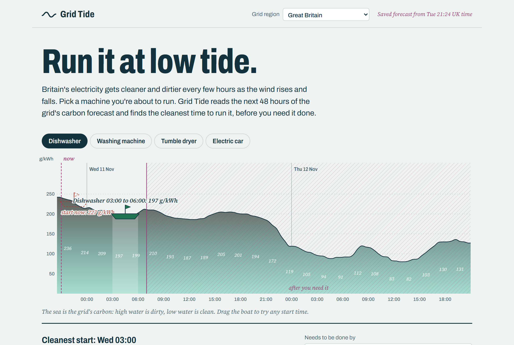
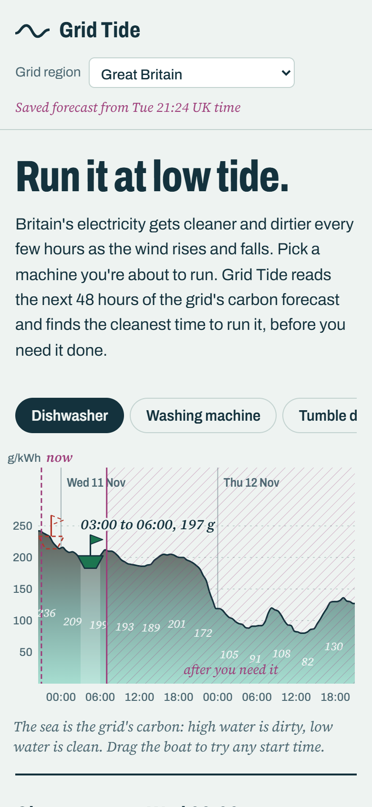

# Grid Tide

**Run it at low tide.** Britain's electricity gets cleaner and dirtier every few hours as the wind rises and falls. Grid Tide reads the next 48 hours of the grid's carbon forecast and finds the cleanest time to run your dishwasher, washing machine, tumble dryer or car charger, before you need it done.

Live: **https://grid-tide.pages.dev**

<!-- VIDEO -->



## What it does

- **Tide chart.** The next 48 hours of grams of CO2 per kWh for Great Britain (or any of its regions) drawn as a sea: high water is dirty, low water is clean. Times after your deadline are hatched out.
- **The boat sails to low water.** Pick a machine and its boat sails from "now" to the cleanest start that still finishes by your deadline. The saving counts down as it goes: grams per run, percent less than starting now, and the generation mix at both times.
- **Drag to try any start.** Drag the boat (or use the arrow keys); every number follows.
- **Remind me.** One button downloads a calendar reminder (.ics) for the chosen start, so the plan actually happens.
- **Tide table.** Every machine on the same forecast, each with its own run length and deadline.
- **Does waiting really help?** A replay of a full year of real grid data (below), and a "your year" estimate built from it, not from tonight's forecast.

No account, no tracking, no server: the page fetches the public forecast straight from the browser.

## The evidence: a year replayed

`npm run replay` replays 17,520 half-hours of Great Britain's national carbon intensity (1 Nov 2025 to 31 Oct 2026). Every evening, a machine could start at 7 pm. Grid Tide picks a start before 7 am from the **forecast**, then both runs are scored on the **actual** intensity. Full tables: [docs/REPLAY.md](docs/REPLAY.md).

| Machine (run length) | 7 pm start, g/kWh | Grid Tide's pick, g/kWh | Cut | Evenings cleaner | Mean wait |
|---|---|---|---|---|---|
| Dishwasher (3 h) | 145.8 | 109.1 | **25.2%** | 90.7% | 6.2 h |
| Tumble dryer (2 h) | 149.3 | 108.8 | **27.1%** | 89.0% | 6.6 h |
| Electric car (4 h) | 141.1 | 109.5 | **22.3%** | 90.1% | 5.7 h |

If the machine can wait up to 24 hours instead of until 7 am, the dishwasher cut rises to **43.2%**. With perfect hindsight, the overnight dishwasher cut would have been 27.1%, so forecast error costs about two points.

What that means in a year, with typical machines: a dishwasher run 5 times a week saves about **8.6 kg** of CO2, and an electric car charged twice a week (28 kWh each) about **92 kg**.

## How it works

1. **Forecast.** One request to the [Carbon Intensity API](https://carbonintensity.org.uk/) (`/regional/intensity/{now}/fw48h`) returns 97 half-hours for Great Britain, its 3 nations and 14 regions, with the generation mix.
2. **Pick.** For a machine that runs *n* half-hours, every start from now to (deadline − *n*) is scored by its mean intensity over the run, using a sliding window. Ties go to the earliest start. CO2 per run = kWh × mean g/kWh. (`src/plan.ts`)
3. **Replay.** The same pick, run day by day on history, scored on actuals. (`src/backtest.ts`, `scripts/replay.ts`)
4. **Fallback.** If the API is unreachable, the page uses a saved forecast and says so in the header (`?saved` shows it on purpose).

## Limits

- The forecast is the grid's **average** intensity. What a shifted load really avoids depends on the **marginal** plant that ramps for it: usually gas at peak, and on windy nights sometimes wind that would otherwise be curtailed. Average intensity is the standard public signal, but treat the grams as an estimate.
- The history keeps the last forecast made for each half-hour; a forecast 12 hours ahead is less accurate, so live savings can be a little lower than the replay.
- Regional history has no actual values, so the replay is national only.
- Live data covers Great Britain only. The method works with any grid forecast, but no other free, keyless forecast is wired in yet.
- Machine figures are typical (EU energy-label ranges); type in the ones on your label.

## Tests

- `npm test`: 26 unit tests. The sliding-window pick matches brute force on 300 random series; deadlines are respected; ties go earliest; London time across the clock change; gap and glitch repair; API parsing; calendar file; the curve never dips below the data.
- `node scripts/e2e.mjs [url]`: 13 checks in Edge on the live site. It captures the forecast the page downloaded, recomputes the cleanest start by brute force in Node and checks the page agrees; then drives the deadline, drag, reminder download, all machines, a region switch and a phone viewport. Last run: [docs/e2e.json](docs/e2e.json).

## Run it

```bash
npm install
npm run dev            # http://localhost:5195
npm test
npm run replay         # rebuilds src/replay.json and docs/REPLAY.md from data/gb-history.json
node scripts/fetch-history.mjs   # re-downloads the year of history
npm run save-forecast  # refreshes the saved fallback forecast
npm run build && npx wrangler pages deploy dist --project-name grid-tide
```



## Credits

- Carbon intensity data: [Carbon Intensity API](https://carbonintensity.org.uk/) by the National Energy System Operator (NESO), licensed CC BY 4.0. `data/gb-history.json` is a copy of its national half-hourly series.
- Fonts: Archivo and Source Serif 4 (SIL Open Font License), self-hosted via Fontsource.
- Built with TypeScript, Vite and Vitest; deployed on Cloudflare Pages.

## License

MIT
